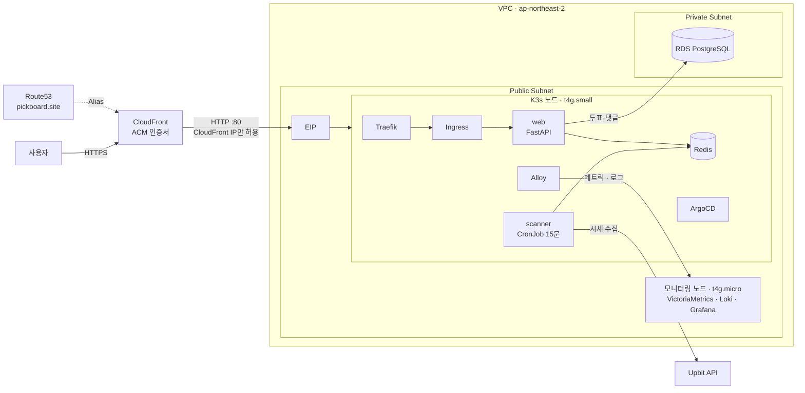

# InfraPilot

**서비스: https://pickboard.site**

내 차트 분석 기법을 코드로 수식화해 업비트 KRW 종목 중 추천 종목을 올리는 서비스입니다.
목적은 앱보다 **직접 설계한 클라우드 인프라를 운영하는 것**에 있습니다.

---

## 아키텍처



| 구성 | 내용 |
|---|---|
| 진입 | Route53 → CloudFront(ACM, HTTP→HTTPS 리다이렉트, 캐시 끔) → 노드 80 |
| 클러스터 | K3s 단일 노드, Traefik(Ingress), ArgoCD |
| 앱 | `web`(FastAPI), `scanner`(CronJob, 15분마다 업비트 수집·분석 → Redis) |
| 데이터 | Redis: 랭킹·캔들(재생성 가능) / RDS PostgreSQL: 투표·댓글(재생성 불가), 프라이빗 서브넷 |
| 관측 | 클러스터 밖 모니터링 노드에 VictoriaMetrics·Loki·Grafana, 노드에서는 Alloy가 전송 |
| 접근 | SSM Session Manager (IAM 인증) |

## 배포 흐름 (GitOps)

```
PR → CI(test · terraform · ansible · manifests · docker) → main merge
   → arm64 이미지 빌드 → ECR push (OIDC, 장기 키 없음)
   → deploy 브랜치에 이미지 태그 커밋 (kustomize edit set image)
   → ArgoCD가 deploy 브랜치의 k3s/ 를 동기화 (prune · selfHeal)
```

| CI 잡 | 검사 |
|---|---|
| `test` | ruff, pytest (외부 의존성 없이 로컬과 같은 결과) |
| `terraform` | `fmt -check`, `validate` |
| `ansible` | `--syntax-check` |
| `manifests` | kubeconform `-strict` (개별 파일 + kustomize build 결과) |
| `docker` | `Dockerfile.web` 빌드 |

## 인프라 코드

| 경로 | 내용 |
|---|---|
| `infra/` | Terraform (S3 backend, `use_lockfile`로 잠금) |
| `infra/modules/` | `vpc`, `security`, `compute`(EC2 + EIP), `dns`(Route53), `edge`(CloudFront + ACM), `rds`, `rds_security`, `ecr`, `cicd`(GitHub OIDC), `monitoring` |
| `infra/ansible/` | 노드 설정: `base-hardening`, `k3s-install`, `network-config`, `ecr-auth`, `docker`, `monitoring-stack` |
| `k3s/` | 앱 매니페스트 (Kustomize): web, scanner, redis, ingress |
| `argocd/` | ArgoCD 설정, Application (앱, Traefik) |
| `alloy/` | Alloy 설정 (메트릭·로그 수집) |
| `docs/RUNBOOK.md` | 배포·검증·철수 절차 |

## 주요 설계 결정

| 결정 | 이유 |
|---|---|
| HTTPS는 CloudFront + ACM | 인증서 발급·갱신을 AWS에 맡기고, 노드에 cert-manager 파드를 늘리지 않음 |
| 노드 80은 CloudFront prefix list만 허용, 443 닫음 | CloudFront 우회 차단. TLS는 엣지에서 종료 |
| EIP로 노드 IP 고정 | 공인 IPv4 단가는 자동 할당과 같고, 재시작해도 원본 주소가 안 바뀜 |
| NAT 제거, 프라이빗 서브넷은 RDS 전용 | 월 약 $14 절감 |
| CI 자격증명은 OIDC | 실행마다 임시 키, main 브랜치로 신뢰 조건 제한 |
| K3s 노드 1대 | 비용. 노드 장애 시 전체 중단은 알고 감수 |
